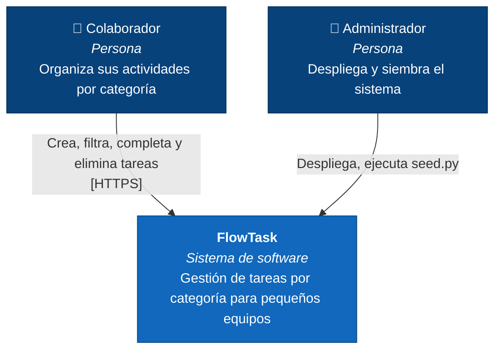
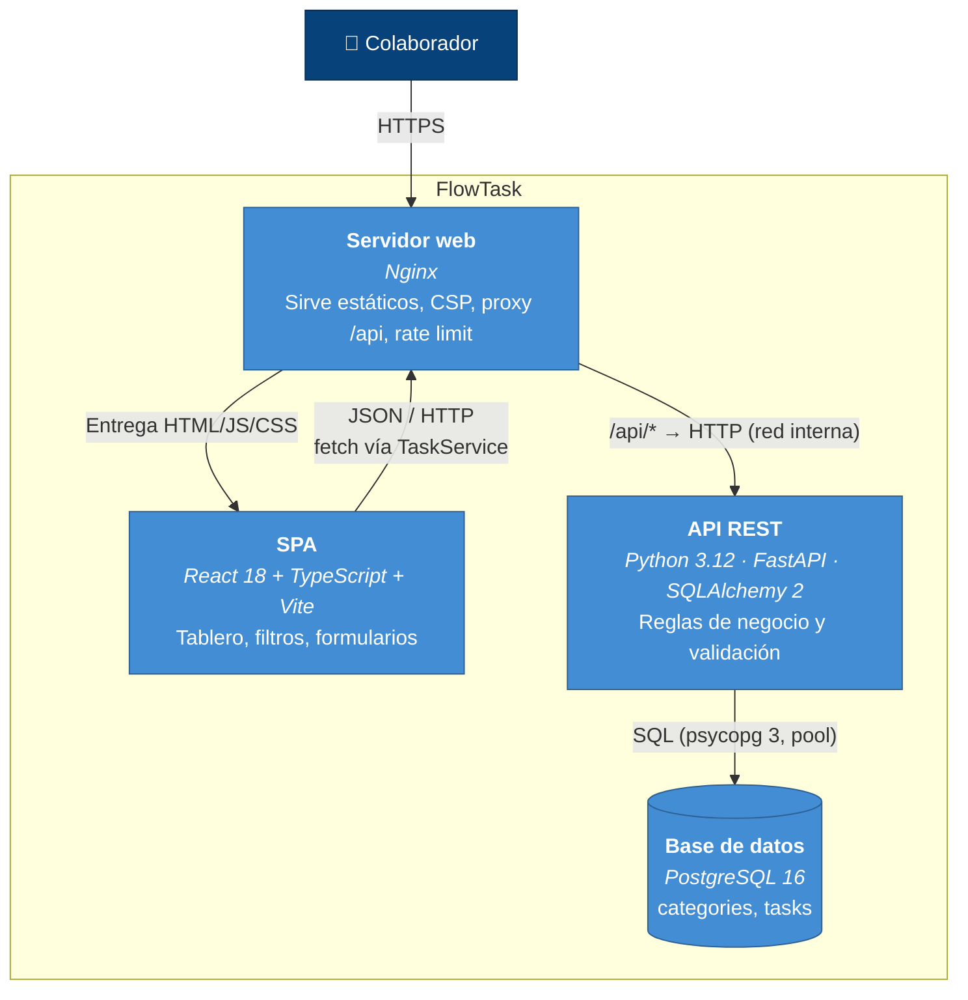
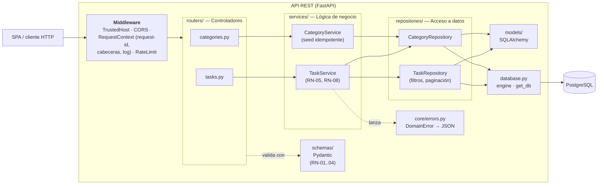
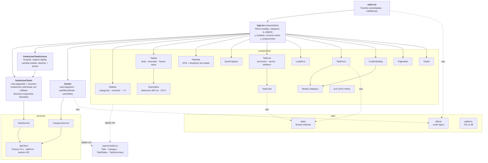
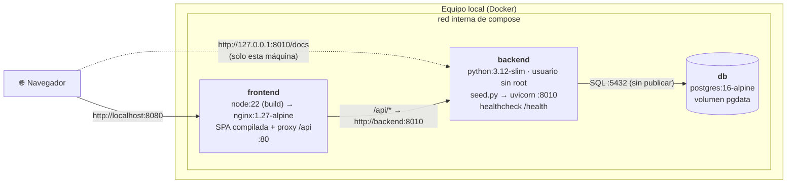
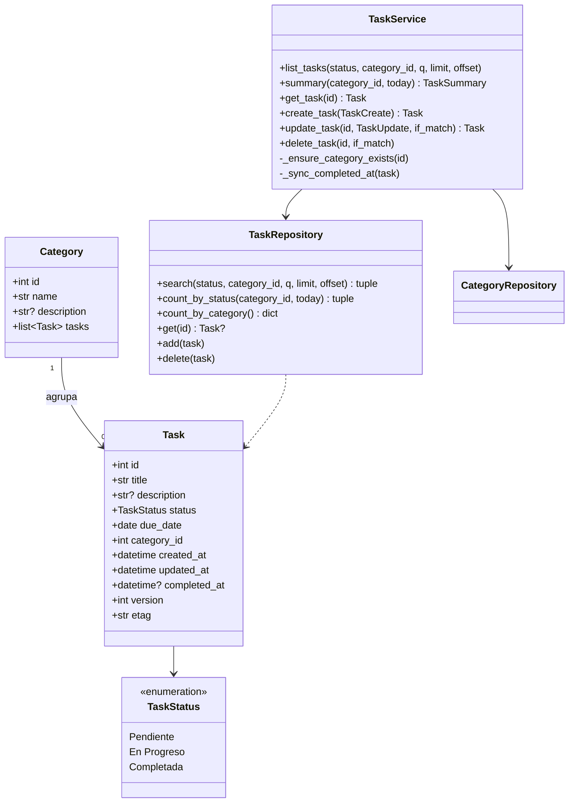
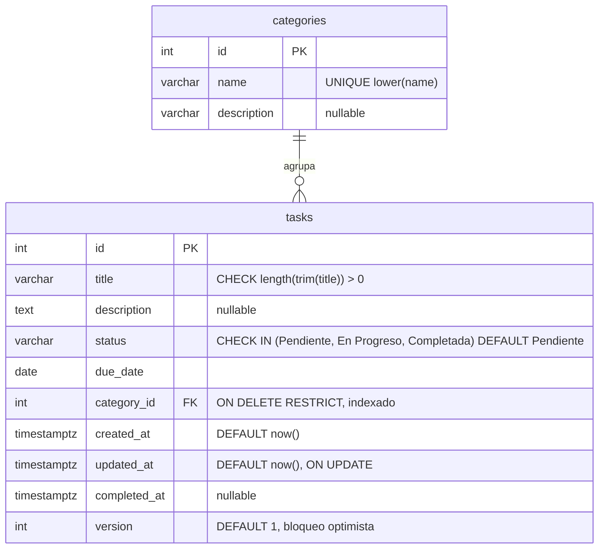
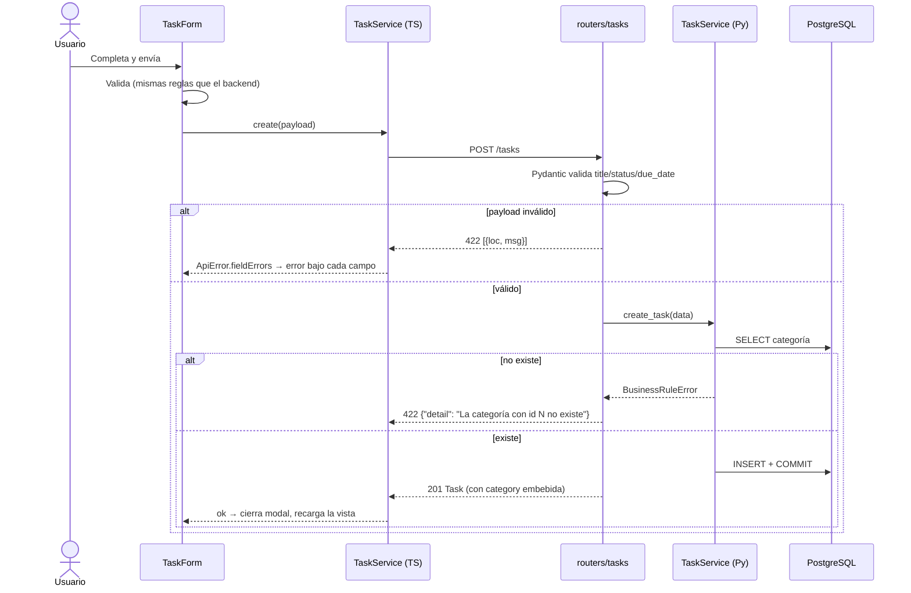
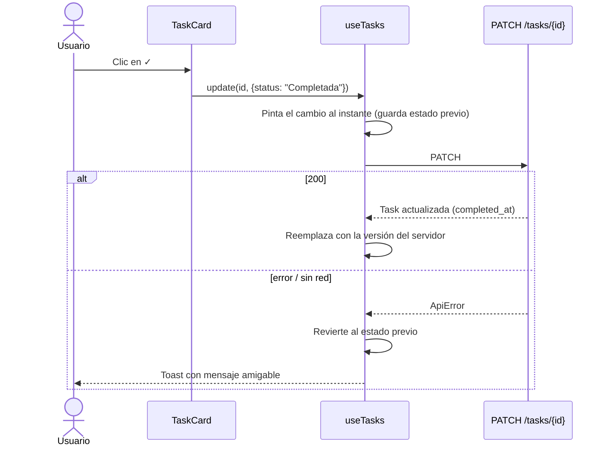
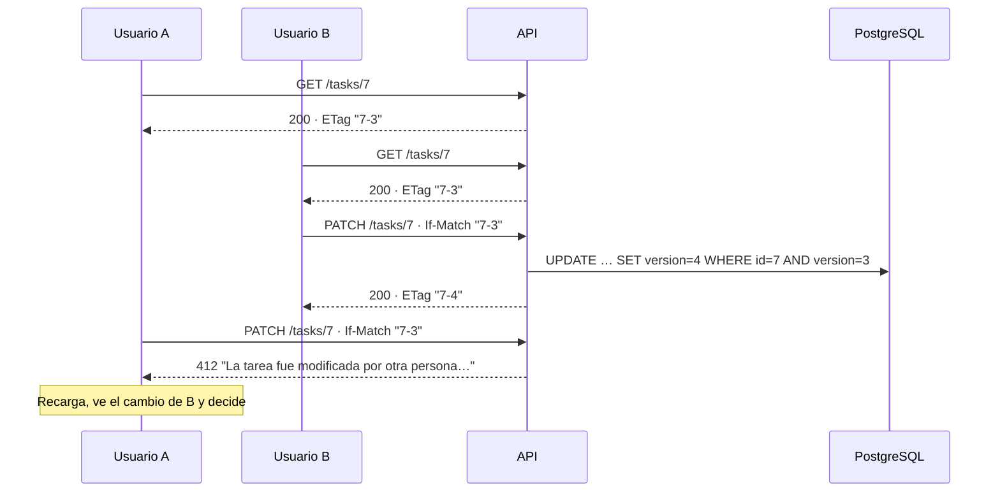

# FlowTask — Arquitectura

Modelo C4 (Contexto → Contenedores → Componentes → Código → Despliegue), modelo
de datos, flujos principales y contrato de la API. Los diagramas son Mermaid (GitHub
los renderiza). El diseño visual y la UX están en [DISENO_UI.md](DISENO_UI.md); los
requerimientos y las reglas de negocio, en [REQUERIMIENTOS.md](REQUERIMIENTOS.md). El
porqué de cada decisión está en los [ADR](adr/README.md); el contrato detallado, en [API.md](API.md).

## C4 · Nivel 1 — Contexto

FlowTask no depende de sistemas externos: es un módulo interno autocontenido.

## C4 · Nivel 2 — Contenedores

En desarrollo la SPA corre en Vite (`:5180`) y llama directo a la API (`:8010`) —
por eso CORS es estricto. En `docker compose` todo pasa por Nginx (mismo origen).

## C4 · Nivel 3 — Componentes del backend

**Regla de dependencias:** cada capa solo conoce a la de abajo. Los routers no
tocan SQL; los repositorios no hacen `commit` (lo decide el servicio = unidad de
trabajo); los servicios no conocen HTTP (lanzan `NotFoundError`/`BusinessRuleError`
y un handler global los traduce).

## C4 · Nivel 3 — Componentes del frontend

Los componentes son **presentacionales**: reciben props y emiten eventos. El estado
del servidor vive en `useTasks`; lo que hace cada acción del usuario (y su aviso), en
`useTaskActions`; el HTTP, solo en `services/`. `App.tsx` no tiene lógica propia: guarda el
estado de la vista y conecta las piezas. `SearchBox` y
`QuickCapture` guardan su propio texto para que escribir no re-renderice el tablero.
El sistema visual está documentado en [DISENO_UI.md](DISENO_UI.md).

## C4 · Despliegue (Docker Compose)

| Entorno | Frontend | API | Base de datos |
|---|---|---|---|
| Desarrollo local | Vite `http://localhost:5180` (si está ocupado, el siguiente: CORS acepta cualquier puerto de localhost en desarrollo) | `http://localhost:8010` | PostgreSQL local o SQLite |
| Docker Compose | Nginx `http://localhost:8080` (mismo origen, sin CORS) | `http://127.0.0.1:8010` | PostgreSQL 16 en contenedor, sin puerto publicado |

Los puertos evitan a propósito los valores por defecto (5173, 8000, 3000, 4200) para
convivir con otros proyectos en la misma máquina. El orden de arranque lo controlan
los healthchecks: `db` sano → `backend` migra, siembra y responde `/health` → `frontend`.

## C4 · Nivel 4 — Código (modelo de dominio)

## Modelo de datos

Índices: `ix_tasks_category_id`, `ix_tasks_status_due_date` (filtro principal del
tablero + orden), `uq_categories_name_lower`. `status` se guarda como `VARCHAR` +
`CHECK` en vez de un `ENUM` nativo de Postgres: agregar un estado nuevo es cambiar
un constraint, no un `ALTER TYPE`, y el mismo esquema funciona en SQLite.

## Flujos principales

### Crear tarea (Caso 2)

### Completar tarea con un clic — actualización optimista (Caso 4)

## Contrato de la API

| Método | Ruta | Descripción | Respuestas |
|---|---|---|---|
| `GET` | `/categories` | Lista de categorías | `200 Category[]` |
| `GET` | `/tasks` | Lista filtrada y paginada. Query: `status`, `category_id`, `q` (título/descripción), `limit` (1–100, def. 50), `offset` | `200 Task[]` + `X-Total-Count`; `422` filtro inválido |
| `GET` | `/tasks/summary` | Conteos para el tablero: por estado, vencidas, que vencen hoy y por categoría. Query: `category_id`, `today` (fecha local del cliente) | `200 TaskSummary` |
| `GET` | `/tasks/{id}` | Detalle | `200 Task` + `ETag`; `404 {"detail":"Tarea no encontrada"}` |
| `POST` | `/tasks` | Crear | `201 Task` + `Location` + `ETag`; `422` validación o categoría inexistente |
| `PATCH` | `/tasks/{id}` | Actualización parcial (p. ej. `{"status":"Completada"}`). `If-Match` opcional | `200 Task` + `ETag`; `404`; `412` versión desactualizada; `409` carrera; `422` |
| `DELETE` | `/tasks/{id}` | Eliminar. `If-Match` opcional | `204`; `404`; `412` |
| `GET` | `/health` | Readiness: base de datos + revisión del esquema | `200 {"status","database","schema","version"}` / `503` |
| `GET` | `/health/live` | Liveness: el proceso responde | `200` |

Errores transversales: `400` Host no permitido · `409` violación de integridad o edición
concurrente · `429` rate limit (con `Retry-After`) · `500 {"detail":"Error interno del servidor.","request_id":"…"}` ·
`503` base de datos caída (con `Retry-After`). Documentación interactiva en `/docs` (solo fuera de producción).

**¿Por qué `X-Total-Count` y no `{items, total}`?** El PDF define `GET /tasks` como
lista de tareas; mantener el cuerpo como arreglo plano respeta ese contrato y la
paginación viaja en una cabecera (expuesta vía CORS con `expose_headers`).

## Concurrencia optimista (ETag / If-Match)

- `If-Match` es **opcional**: sin él, gana la última escritura (lo que el PDF espera).
- Aun sin `If-Match`, si dos `UPDATE` parten de la misma lectura, el `WHERE version = :leída`
  del segundo no encuentra fila y SQLAlchemy lanza `StaleDataError` → `409`.
- Cada tarea expone también `version` en el cuerpo, para clientes que no leen cabeceras.

## Migraciones

| Revisión | Cambio |
|---|---|
| `0001` | Esquema inicial: `categories`, `tasks`, constraints e índices |
| `0002` | `tasks.version` (bloqueo optimista), con `server_default` para filas existentes |

- `alembic upgrade head` (CLI) o `python seed.py` (migra + siembra). En desarrollo, la API lo hace al arrancar.
- **Adopción de bases previas:** si existe `tasks` pero no `alembic_version` (base creada con
  `create_all`), se marca como `0001` y se aplica lo pendiente, sin perder datos.
- **Garantías probadas** (`tests/test_migrations.py`): las migraciones generan exactamente el
  esquema de los modelos (`compare_metadata` vacío), `downgrade base` + `upgrade head` funciona,
  y la adopción de una base previa conserva sus datos.
- Regla de evolución: migraciones **aditivas** (compatibles con la versión anterior del
  código), para poder volver atrás una versión sin tocar el esquema.

## Observabilidad

- **`request_id` de punta a punta:** se genera por request (o se reutiliza el `X-Request-ID`
  entrante si es seguro), vuelve en la respuesta y aparece en cada línea de log. Un `500`
  incluye el `request_id` en el cuerpo para que soporte lo encuentre en segundos.
- **Logs estructurados:** `LOG_FORMAT=json` emite una línea JSON por evento
  (`ts, level, logger, msg, request_id, status, duration_ms, client_ip`), lista para
  journald/Loki/CloudWatch. En desarrollo, formato texto legible.
- **Health checks separados:** `/health/live` (el proceso responde) y `/health`
  (base de datos + revisión de esquema), usado por el healthcheck de Docker.

## Calidad y CI

| Control | Herramienta | Dónde |
|---|---|---|
| Estilo y bugs comunes (incl. reglas de seguridad `bandit`) | `ruff check` + `ruff format` | local, CI |
| Tipos | `mypy --strict` + plugin de Pydantic | local, CI |
| Pruebas + cobertura ≥ 90 % | `pytest` + `pytest-cov` (79 pruebas, 98 %) | local, CI |
| Mismo código en ambos motores | pruebas en SQLite **y** PostgreSQL 16 | CI (Python 3.10 y 3.12) |
| Frontend compila con tipos estrictos | `tsc` + `vite build` | CI |
| El stack completo levanta y cumple los 5 casos | `docker compose up --wait` + `curl` vía Nginx | CI |

## Seguridad aplicada

Mismo enfoque de capas que uso en IndexUNI en producción, acotado a lo que vive en este
repositorio. El modelo de amenazas completo está en [SEGURIDAD.md](SEGURIDAD.md).

| Capa | Control |
|---|---|
| Borde (Nginx del contenedor) | CSP `'self'` sin `unsafe-*` ni scripts inline, `X-Frame-Options DENY`, `nosniff`, `Referrer-Policy`, `Permissions-Policy`, `server_tokens off`, `limit_req` por IP (`429`), `client_max_body_size 64k`, dotfiles bloqueados, `X-Forwarded-For` sobrescrito (no falsificable). |
| API | CORS por lista blanca exacta (orígenes, métodos, cabeceras; sin credenciales) · `TrustedHostMiddleware` · rate limit por IP (`slowapi`) · CSP `default-src 'none'` en JSON · `Cache-Control: no-store` · docs apagadas en producción · **la config se niega a arrancar en producción si es permisiva** · `statement_timeout` en PostgreSQL · `--no-server-header`. |
| Entrada | Pydantic tipa y acota todo; ORM con parámetros enlazados (sin inyección SQL); búsqueda con `autoescape` (`%`/`_` literales). |
| Errores y logs | Nunca stack traces al cliente; `request_id` para correlacionar; `X-Request-ID` entrante solo si es alfanumérico (sin inyección en logs). |
| Datos | Integridad en la base (`CHECK`, `FK RESTRICT`, `UNIQUE`) y bloqueo optimista contra ediciones concurrentes. |
| Contenedores | Imagen de la API sin root, base sin puertos publicados, API publicada solo en `127.0.0.1`. |
| Frontend | React escapa todo el contenido; confirmación antes de borrar; timeout en peticiones. |